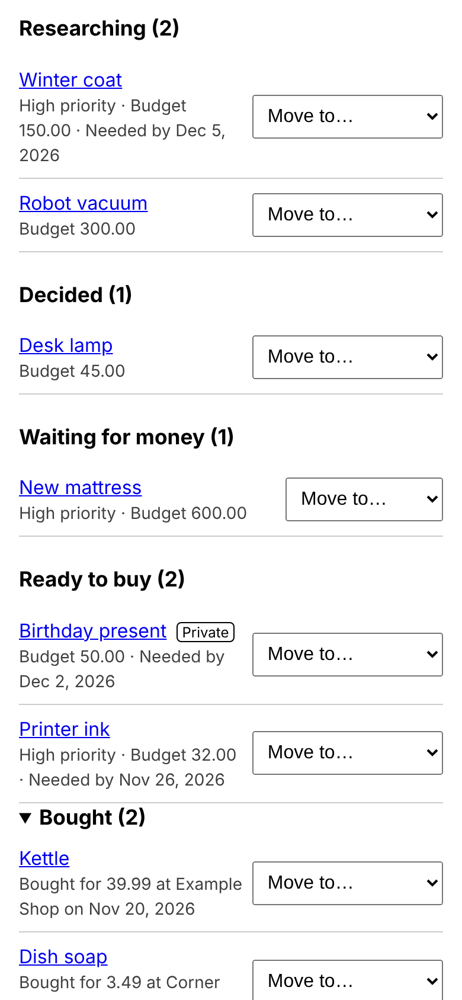
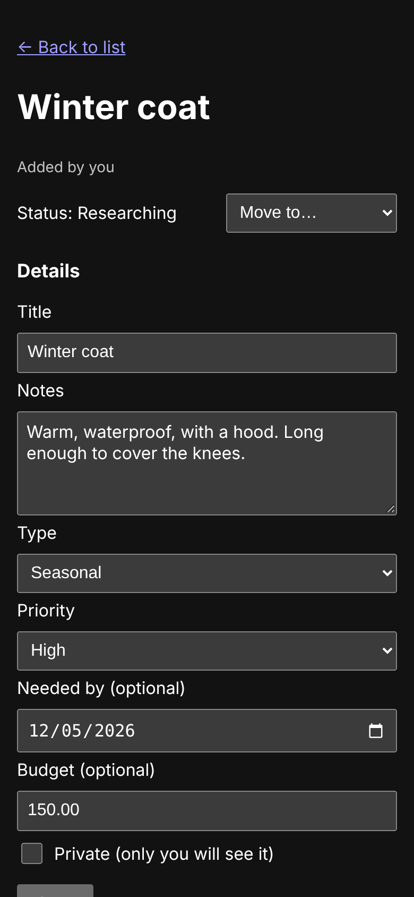
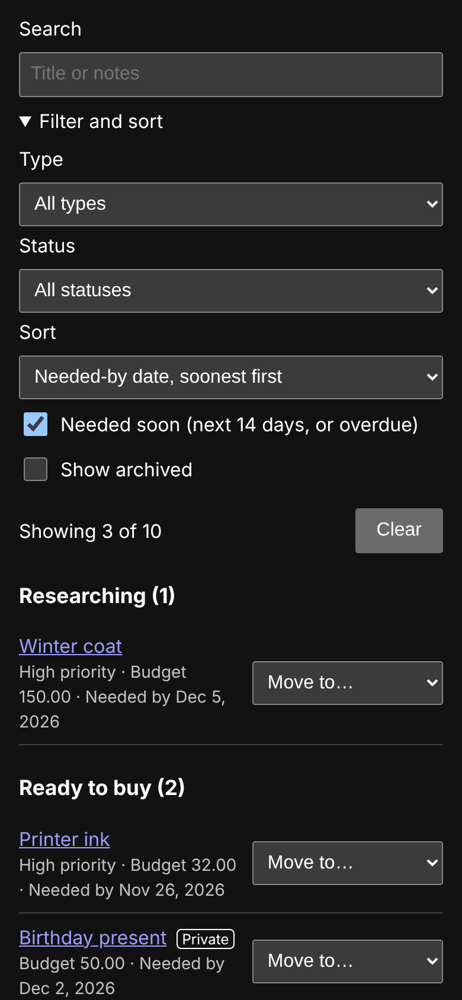
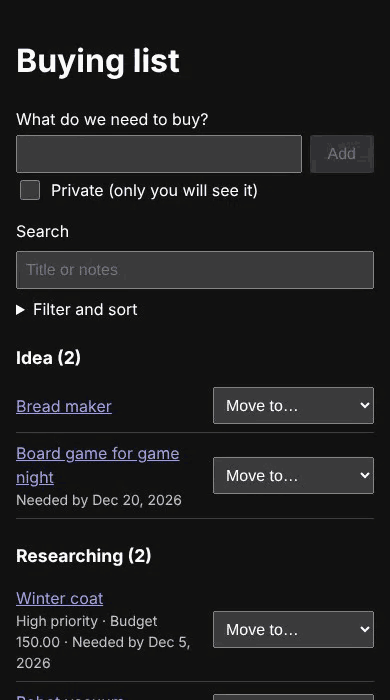

# buying-list

A shared household buying list, installed on your phone, that tracks things from idea to bought and does the product research for you.

## What it looks like

The app as it stands at the end of Phase 3, taken in a phone-sized browser in dark mode, from a local copy filled with invented items. The app follows the phone's light or dark setting.

<p>
  
  
  
</p>

From the left: the list grouped by status, one item's page, and the list narrowed to what is needed soon. Below the part shown, an item's page also holds its links, and buttons to archive or delete it.



Adding an item, moving it along, and marking it bought.

## Status

Phases 2 and 3 of the [roadmap](ROADMAP.md) are built, and the app is in real use for a few weeks before Phase 4. The back end is complete: the full item model, the API and a tested database layer. The list is grouped by status, with a quick-add box and a way to move each item along, including recording a purchase. Each item records who added it, and can be private, so that only that person sees it. Each item has its own page for editing its details and links, and for archiving or deleting it. The list can be searched, filtered by type, status and "needed soon", sorted, and can show archived items. It can be added to a phone's home screen and opens like an app.

- [`ROADMAP.md`](ROADMAP.md): what is being built, in what order.
- [`docs/decisions/`](docs/decisions/): why it is being built this way, and what else was considered.
- [`SECURITY.md`](SECURITY.md): how the app and this repository are protected, and how to report a problem.
- [`AGENTS.md`](AGENTS.md): the rules that AI coding agents follow here.

This README will grow into a full guide as the app takes shape.

## How it works

One Cloudflare Worker does everything the server side needs to do.

```
browser ──▶ Cloudflare Access (sign-in) ──▶ Worker ──▶ D1 database
                                              │
                                              └──▶ the front end's files
```

- `src/`: the front end, written in React and built by Vite. Plain React and plain CSS, with no other libraries. Its parts:
  - `App.tsx`: loads the list once and holds it, shows the page the address points at, and swaps in each item the server sends back after a change.
  - `route.ts` and `navigation.tsx`: which page to show for an address (`/` for the list, `/items/12` for an item), and moving between pages without a reload, so the phone's back button works. The Worker answers any address that is not a file or an API route with the app's page, which is what lets `/items/12` open directly.
  - `ListPage.tsx`, `QuickAdd.tsx`, `FindBar.tsx`, `StatusSection.tsx` and `ItemRow.tsx`: the list, with its search and filters.
  - `ItemPage.tsx`, `DetailsForm.tsx`, `LinksSection.tsx` and `DeleteSection.tsx`: one item's page.
  - `MoveSelect.tsx`, `useStatusMove.ts` and `BoughtForm.tsx`: the Move to menu and its bought form, shared by both pages.
  - Each piece that changes something makes its own request, so it can show "saving" and errors where the person tapped.
  - `api.ts`: the only file that calls the API.
  - `find.ts`, `groups.ts`, `format.ts`, `itemForm.ts` and `route.ts`: plain functions with tests, for search, filters and sort, grouping the list, reading and showing prices and dates, turning the item form into only the changed fields, and reading addresses.
  - `labels.ts`: the names people read for the API's fixed words.
- `worker/`: the Worker. It uses [Hono](https://hono.dev) for the API routes, checks the Access token on every request, and hands everything that is not an API call to the front end's files. Its parts have separate jobs:
  - `items.ts`: the routes. Only the web side: read the request, call the pieces below, send the answer.
  - `validation.ts`: what the API accepts, as [Zod](https://zod.dev) schemas. It never touches the database.
  - `status.ts`: the rules for moving an item between statuses, as a plain function.
  - `queries/items.ts`: the only file that contains SQL. It is also where private items are enforced: every query that reads or changes an item only matches items that are shared or were added by the person asking.
  - `test-support/`: a real local database for tests.
- `public/`: files served as they are. `manifest.webmanifest` tells a phone the app's name, icon and how to open it, and `icons/` holds the icon: `icon.svg` is the source, and the PNGs are copies of it at the sizes phones ask for.
- `shared/`: the few things the front end and the Worker must agree on, such as the longest title. Both import from here.
- `migrations/`: the database's tables, as numbered SQL files.
- `wrangler.jsonc`: tells Cloudflare what the Worker is and what it is connected to.
- `tsconfig*.json`: strict TypeScript settings in three projects, for the front end (browser), the Worker (Cloudflare's runtime) and the tooling (Node), because each has different built-in features. `tsconfig.base.json` holds what they share.

### The API

Every route needs the sign-in token, and answers as the person it names: a private item someone else added is "Not found" to you, on every route. Anything that changes data must be sent with the header `Content-Type: application/json`, even when there is no body. Errors are JSON, `{ "error": "..." }`, with status 400 for input that is not valid, 403 for trying to change whether someone else's item is private, 404 for an item or link that does not exist or that you may not see, and 415 for a missing JSON header.

| Route | What it does |
| --- | --- |
| `GET /api/me` | Who is signed in: `{ "email": "..." }`, as read from the sign-in token. |
| `GET /api/items` | Lists the items you may see, with their links, newest first. Archived items are left out unless you add `?archived=true`. |
| `GET /api/items/:id` | One item. |
| `POST /api/items` | Adds an item. Only `title` is required. Optional: `notes`, `type`, `priority`, `neededBy` (`YYYY-MM-DD`), `budgetCents`, `isPrivate`. A new item is an idea, and records you as the person who added it. |
| `PATCH /api/items/:id` | Changes any of those fields. Fields left out stay as they are, and `null` clears the date or budget. Only the person who added an item may change `isPrivate`. |
| `POST /api/items/:id/status` | Moves the item to a status: `idea`, `researching`, `decided`, `waiting_for_money`, `ready_to_buy` or `bought`. Any status can move to any other. `bought` also takes optional `boughtOn`, `paidCents` and `boughtFrom`. Moving out of `bought` clears them, and sending `bought` again for an item that is already bought keeps what it has, apart from any detail you send, so a price can be corrected. |
| `POST /api/items/:id/archive` and `/unarchive` | Hides an item from the list, or brings it back. |
| `DELETE /api/items/:id` | Deletes an item and its links for good, answering 204 with no body. |
| `POST /api/items/:id/links` | Adds a link: `url` (must start with `http://` or `https://`) and an optional `label`. |
| `DELETE /api/items/:id/links/:linkId` | Removes a link. |

Every item and link route answers with the whole item as it now is, `{ "item": ... }`. Money is a whole number of cents. Fields the API does not know are refused, not ignored.

## Set up and run on your own computer

You need [Node.js](https://nodejs.org) 24 or newer (the version is in `.nvmrc`) and Git. On Windows, run the commands in Git Bash.

```bash
npm install
cp .dev.vars.example .dev.vars    # local settings, ignored by git
npm run db:migrate:local          # creates the local database
npm run dev                       # opens the app on http://localhost:5173
```

Locally the sign-in check is skipped, and only for requests to `localhost` or `127.0.0.1`. That is the `DEV_SKIP_ACCESS` line in `.dev.vars`, and `DEV_USER_EMAIL` says who you are signed in as. To see the app as a second person, for example to check that a private item is hidden, change `DEV_USER_EMAIL` and restart `npm run dev`. If you open the dev server by any other address, such as your computer's network address from a phone, the app answers with a configuration error. That is deliberate.

| Command | What it does |
| --- | --- |
| `npm run dev` | Runs the app locally, with a local database. |
| `npm run check` | Type check, lint, format check, tests and build: everything the GitHub check runs. |
| `npm run format` | Fixes formatting. |
| `npm run build` | Builds the front end and the Worker into `dist/`. |
| `npm run deploy` | Builds, then deploys with Wrangler. |

## Deploy your own copy

You need a free [Cloudflare account](https://dash.cloudflare.com/sign-up) with Cloudflare Zero Trust set up (the free plan covers up to 50 people).

1. Sign in: `npx wrangler login`.
2. Create the database: `npx wrangler d1 create buying-list`. Copy the `database_id` it prints into `wrangler.jsonc`.
3. Create the table: `npm run db:migrate:remote`.
4. Deploy: `npm run deploy`. Until step 6 is done the app answers every request with an error, because it refuses to run without its sign-in settings.
5. Put Cloudflare Access in front of the Worker. In the Cloudflare dashboard, open the Worker's settings, find its `workers.dev` address and turn on Cloudflare Access. Then, in Zero Trust under Access, open the new application and make sure the policy lists only the people who may use the app.
6. Give the Worker its two sign-in settings, which name your own account and so are not kept in this repository. Wrangler asks for each value, and the characters do not show as you paste.
   - `npx wrangler secret put TEAM_DOMAIN`: your team address, such as `https://YOUR-TEAM.cloudflareaccess.com`. The team name is the one you chose when you set up Zero Trust, shown in its settings and in the address bar of the sign-in page. Start with `https://` and put nothing after the name.
   - `npx wrangler secret put POLICY_AUD`: the Application Audience (AUD) tag, shown on the Access application's overview.

Open the Worker's address. You should be asked to sign in, and then see the list.

To share the list with someone else in your household:

1. Let them sign in with an emailed code. New Zero Trust accounts start with only the Cloudflare sign-in, which admits members of your Cloudflare account and nobody else ([Cloudflare's note on the change](https://developers.cloudflare.com/changelog/post/2026-06-18-cloudflare-idp-default/)). In Zero Trust, go to **Integrations**, then **Identity providers**, select **Add new identity provider** and choose **One-time PIN** ([Cloudflare's guide](https://developers.cloudflare.com/cloudflare-one/integrations/identity-providers/one-time-pin/)). Then open the Access application's **Authentication** settings and tick One-time PIN as well as the Cloudflare sign-in.
2. Add their email to the policy. Open the Access application's policy, select **Add include (OR)**, choose **Emails** and enter their exact address. Leave the existing rule in place: it is what lets you in. Typing their email into the existing "Cloudflare Account Member" rule does not work, because they are not a member of your account.

They then open the app, enter their own email and type the code Cloudflare sends them. Their email is how the app knows who added each item.

### Put it on a phone

Open the app's address in the phone's browser and sign in. Then:

- **Android, Chrome:** open the menu (three dots) and choose **Add to home screen**, then **Install**.
- **iPhone, Safari:** tap **Share**, then **Add to Home Screen**.

The app opens from its icon, without the browser's address bar. On an iPhone, an app on the home screen keeps its own cookies, separate from Safari, so you sign in once more the first time you open it.

### If you are refused after signing in

The Worker logs why it refused a request, and never tells the visitor. Read the log with:

```bash
npx wrangler tail buying-list --format pretty
```

Then reload the page and look for a line starting `Access token refused` or `Access check is not configured`. Two common causes:

- `Expected 200 OK from the JSON Web Key Set HTTP response`: `TEAM_DOMAIN` is not your team address. Open `YOUR-TEAM-ADDRESS/cdn-cgi/access/certs` in a browser. It should show JSON containing `keys`.
- A message about the `aud` claim: `POLICY_AUD` belongs to a different Access application.

## Configuration

| Setting | Where it is set | What it is |
| --- | --- | --- |
| `database_id` | `wrangler.jsonc` | Which D1 database the Worker uses. |
| `TEAM_DOMAIN` | Worker secret | Your Access team address. |
| `POLICY_AUD` | Worker secret | The Access application's audience tag. |
| `DEV_SKIP_ACCESS` | `.dev.vars` | Local development only. Skips the sign-in check for `localhost` and `127.0.0.1`. |
| `DEV_USER_EMAIL` | `.dev.vars` | Local development only. Who you are signed in as while the check is skipped. |

## Costs

Nothing, on the free plans of Cloudflare Workers, D1 and Access. The figures and their sources are in [decision 0001](docs/decisions/0001-stack-and-hosting.md).

## Limitations

- Search, filters and sort run on the phone over the whole list, which it loads in one go, archived items included. That is quick for hundreds of items, but not for many thousands.
- Search matches whole phrases in titles and notes, not separate words in any order. "Needed soon" means the next 14 days or overdue, a fixed number in `src/find.ts`.
- Search and filter choices last until the app is reloaded.
- The app needs a connection. Nothing works offline, and an app on the home screen shows a browser error page when there is no signal.
- When the sign-in expires, the installed app shows Cloudflare's sign-in page, as the browser does.
- Items added before the app recorded who was signed in have no adder. They stay shared, and nobody can make them private.
- The app shows the other person by their sign-in email, not a name.
- A private item is hidden from the other person, but anyone with access to the Cloudflare account can still read the database.
- Two people editing the same item at once: the last save wins.
- Through the API, the purchase date defaults to today in UTC, which can be a day off late in the evening. The screen avoids this by sending the phone's own date.
- Prices are whole cents with no currency, because one deployment uses one currency. The screen shows them as plain numbers such as 12.50, and accepts a comma or a dot as the decimal mark.
- The tests run the queries against a real local database, but not the deployed one. After deploying, `npm run db:migrate:remote` applies new migrations to it.

## How this is built

The project is built in the open, one reviewed pull request at a time, with AI coding agents doing much of the writing. Every pull request explains why its approach was chosen.

## Pre-push check

Everything pushed to a public repository is public straight away, so this repository includes a check that runs on your own computer before anything leaves it.

**What it covers:** pushes made with `git push` from a computer where you have set it up. Nothing else.

**What it does not cover:** pushes made by cloud coding agents, and anything typed on github.com. Those rely on a different protection: agents working here are given no private material to begin with. See "Separation" in [`AGENTS.md`](AGENTS.md).

It refuses a push if a commit:

- was written under the wrong name or email, or
- contains a term from your private list, in its changes, file names, commit message or branch name.

The script is in [`.githooks/pre-push`](.githooks/pre-push). It contains no private terms. It reads them from a file that you keep outside the repository.

### Setup

Do this once for each copy of the repository. On Windows, run the commands in Git Bash, which is installed with [Git for Windows](https://git-scm.com/downloads).

1. Create your private list: a plain text file with one term per line, saved outside this repository. The default location is a file named `.private-terms.txt` in your home folder. Lines starting with `#` are ignored, and matching ignores upper and lower case.

2. Tell git who the commits should be from, and what the check should expect. Use your own public name and email.

   ```bash
   git config user.name "YOUR PUBLIC NAME"
   git config user.email "YOUR PUBLIC EMAIL"
   git config prepush.authorName "YOUR PUBLIC NAME"
   git config prepush.authorEmail "YOUR PUBLIC EMAIL"
   ```

3. Switch the check on.

   ```bash
   git config core.hooksPath .githooks
   ```

4. If your list is somewhere other than the default location, say where.

   ```bash
   git config prepush.termsFile "/path/to/your/file"
   ```

### Run the tests

The check has its own tests. They build a throwaway repository in a temporary folder, with made-up terms, and try thirteen pushes. Nothing touches this repository, GitHub or your real list.

```bash
sh tests/pre-push.test.sh
```

The last line should read `13 passed, 0 failed`.

### Check that it works for you

Make a throwaway commit containing one of your terms on a test branch, and try to push it. The push should be refused, and nothing is sent. Then delete the test branch.

### Other limits

- It cannot read images or other binary files.
- It only knows the terms on your list.

It can be skipped with `git push --no-verify`. Do not do that.

## Licence

[MIT](LICENSE)
